  

<h1 align="center">Reuven Kazorer</h1>

  <b>I build AI solutions and lead a team that ships AI and BI systems.</b> 
  Agents and automations, internal tools, Power BI dashboards, and the decks and videos that show them off.

  
  
  

<!-- github-cool-readme cards: generated by .github/workflows/cool-readme.yml on the "cards" branch -->

<picture>
  <source media="(prefers-color-scheme: dark)" srcset="https://raw.githubusercontent.com/reuvenkazorer27/reuvenkazorer27/cards/about-dark.svg">
  
</picture>
<picture>
  <source media="(prefers-color-scheme: dark)" srcset="https://raw.githubusercontent.com/reuvenkazorer27/reuvenkazorer27/cards/summary-dark.svg">
  
</picture>

---

## Featured

### 🎬 [repo2demo](https://github.com/reuvenkazorer27/repo2demo) · is this AI repo worth *your* time?

Paste a GitHub link: Claude judges the repo against **your** profile (role, stack, data rules, machines), gives a
verdict with evidence and makes a 30-second demo video with a practical example. A `skip` gets no video, just a clear
"why not". Built to turn a growing pile of saved repos into decisions.

  

### 📊 [PBI HTML Content Agent](https://github.com/reuvenkazorer27/pbi-html-content-agent) · pixel-exact Power BI dashboards from one prompt

An agent kit that builds Power BI dashboards on the HTML Content visual: fitted to your data, brand and readers,
LTR or RTL, with colour and motion where they earn it. Writes straight into PBIP/PBIR, checks every build (fit, WCAG
contrast, stress, regression) and versions it like code. Installs as a Claude Code plugin or with `npx`.

  

### More

| | |
|---|---|
| [**Skills Manager**](https://github.com/reuvenkazorer27/skills-manager) | Local observability, cost and token dashboard with real-time quota tracking for Claude and Antigravity on Windows |
| [**Power BI Design Intelligence**](https://github.com/reuvenkazorer27/ui-ux-pro-max-powerbi-analytics) | Design toolkit for Power BI authoring: BM25 search over palettes, KPI cards, chart types, layouts and DAX patterns |
| [**Close Other Windows**](https://github.com/reuvenkazorer27/close-other-windows) | Chrome extension that closes every other browser window in one click |
| [**LinkedIn Power BI Dashboard**](https://github.com/reuvenkazorer27/linkedin-power-bi-) | LinkedIn analytics dashboard built with Power BI, DAX and HTML visuals |

---

## How I work

- **AI first, the right platform second.** Sensitive data stays on approved, in-house platforms; everything else goes
  wherever it works best.
- **Agents with guardrails.** Skills, subagents, hooks and MCP servers, with checks that prove a result before
  anyone calls it done.
- **Show the before and after.** Every tool ships with a deck, a demo or a short video, so people can see why it matters.

<picture>
  <source media="(prefers-color-scheme: dark)" srcset="https://raw.githubusercontent.com/reuvenkazorer27/reuvenkazorer27/cards/languages-dark.svg">
  
</picture>
<picture>
  <source media="(prefers-color-scheme: dark)" srcset="https://raw.githubusercontent.com/reuvenkazorer27/reuvenkazorer27/cards/weekly-dark.svg">
  
</picture>

  
  
  
  
  
  
  
  
  

Cards by <a href="https://github.com/pedrocatalao/github-cool-readme">github-cool-readme</a>, updated every two hours.

